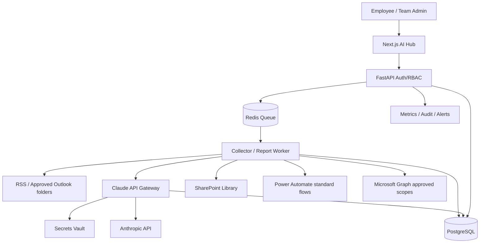
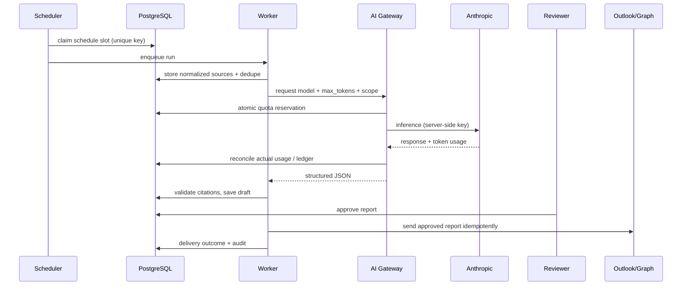

# 02 — System Architecture

## Architecture decisions
- Web: Next.js + TypeScript, server-side auth session; API: FastAPI/Python; jobs: Celery/Redis (or managed queue after POC); PostgreSQL; SharePoint archive; Entra ID OIDC.
- Anthropic Claude **API** via centralized backend gateway; Claude Team Chat license is distinct from API billing. Secrets in Key Vault (production) or encrypted secret manager; no user-visible shared token.
- Power Automate retained for existing standard connector flows where license permits; avoid Premium HTTP/custom connector assumption. Use Graph with tenant-approved app permissions for controlled backend integrations; verify security review.

## Execution sequence

## Trust boundaries & auth
1. Browser → backend: Entra OIDC authorization code + PKCE; HttpOnly secure cookie, CSRF protections; API authorizes **each** workspace/resource.
2. Backend → Anthropic: service secret only; provider workspaces and keys scoped per budget pool.
3. Backend → Microsoft Graph: app-only access only when supported with least privilege (e.g. Sites.Selected, mailbox scoping); delegated where needed; admin consent; no blanket read-all.
4. Collector: external URLs allowlisted, DNS rebinding checks, outbound proxy, block RFC1918/metadata IP, content-type and max bytes, timeouts; HTML/email untrusted.
5. Workers isolated from frontend; no arbitrary code execution or dynamic external tool calls from model output.

## Failure handling
- RSS/Graph unavailable: source-level partial failure, continue other sources, annotate incomplete report.
- Anthropic 429/5xx: exponential backoff + jitter; hard per-run max retries; reconcile stale reservations.
- Model returns invalid JSON or unverifiable citations: one bounded repair attempt; then needs-review/error, never auto-send.
- Email timeout: query delivery idempotency state before retry; prevent duplicate sends.
- Worker crash: lease timeout + reclaim, unique schedule key, durable job state; DLQ.
- Quota exhausted: hard deny and admin notification; never silently fall back to a different team key.

## Data flow / retention
- Source snapshots with minimal text + URL + fetched_at; PII redact before sending model; classified documents require explicit policy approval.
- Approved reports archived to SharePoint team-specific library; SQL holds normalized metadata, provenance, versions and usage ledger.
- Suggested 90d raw / 365d audit are placeholders for data owner signoff; support purge/export.

## Deployment topology
- Pilot: isolated Ubuntu 24.04 VM(s), Docker Compose, PostgreSQL backups, TLS reverse proxy, separate worker, Redis persistence policy, outbound egress restrictions.
- Production: separate DB storage and workers, HA/backup, key vault, centralized logs (Wazuh), secret rotation, SAST/DAST, container image scanning, daily backup restore tests.
- Do not deploy directly to SOC VM without capacity/security isolation assessment.

## Integration boundary contract
- Collector adapter: `collect(config, cursor) -> normalized_items[]`.
- LLM adapter: `analyze(evidence_refs, policy, schema) -> report_json + usage`.
- Dispatcher: `dispatch(approved_report_id, recipients, idempotency_key) -> delivery_receipt`.
- Power Automate integration initially via shared SharePoint list polling/trigger, **not** premium HTTP trigger; verify connector availability in tenant.

## Observability
Metrics: jobs scheduled/completed/failed, source freshness, dedupe ratio, p95 generation latency, tokens/cost/team, quota denies, report approval lag, email sends, API 429, invalid citations, failed logins. Alert: repeated job failure, budget 80/100%, stale feeds, auth errors, suspected prompt injection.
